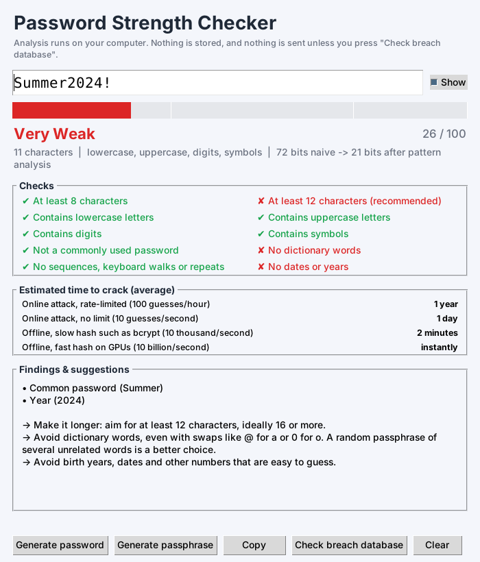

# Password Strength Checker

A pattern-aware password strength checker, generator and auditor written in pure Python (standard library only).
It estimates how long an attacker would really need to guess a password, explains *why* a password is weak
and tells you how to fix it - in a desktop GUI or in the terminal.

> **Course:** _your course name_ &nbsp;|&nbsp; **Assignment:** Week 05 &nbsp;|&nbsp; **Author:** _your name_



## Features

- **Pattern-aware scoring** - detects common passwords (top 10,000 leaked), dictionary words (including
  `P@ssw0rd`-style substitutions), sequences (`abcd`, `4321`), keyboard walks (`qwerty`, `1qaz`),
  repeats (`aaaa`, `abcabc`) and years/dates.
- **Entropy estimate** - naive entropy vs. effective entropy after pattern analysis.
- **Crack-time estimates** for four attack scenarios (rate-limited login → offline GPU attack).
- **Checklist and suggestions** - tells you exactly what to change.
- **Breach check (optional)** - Have I Been Pwned using *k-anonymity*: only the first 5 characters of the
  SHA-1 hash are sent, never the password.
- **Generators** - secure random passwords and word passphrases using Python's `secrets` module.
- **Two interfaces** - Tkinter GUI with a live meter, and a CLI (`check`, `generate`, `passphrase`, `batch`)
  with JSON output and `--min-score` exit codes for scripts.
- **Privacy by design** - hidden prompt input, passwords are never logged or stored, batch mode never prints
  passwords, JSON output omits password fragments, the GUI clipboard is cleared after 30 seconds.
- **36 unit tests** and a GitHub Actions workflow.

## Quick start

Requires **Python 3.8+**. No `pip install` needed.

```bash
git clone https://github.com/<your-username>/password-strength-checker.git
cd password-strength-checker

python main.py                    # opens the GUI (falls back to the terminal if no display)
python main.py check              # terminal check with hidden input
python main.py check --online     # + breach lookup (needs internet)
python main.py generate -l 20     # secure random password
python main.py passphrase -w 6 --capitalize --add-number
python main.py batch my_list.txt  # audit a file, one password per line
python main.py -h                 # every option
```

On Debian/Ubuntu the GUI needs Tkinter: `sudo apt install python3-tk`.

### Example

```text
$ python main.py check
Enter password (hidden):
Password Strength Report
──────────────────────────
Strength : Very Weak  [██████░░░░░░░░░░░░░░░░░░] 26/100
Length   : 11 characters
Charsets : lowercase, uppercase, digits, symbols (pool of 95)
Entropy  : 72.3 bits naive -> 20.9 bits after pattern analysis

Estimated time to crack (average case):
  Online attack, rate-limited (100 guesses/hour)          1 year
  Online attack, no limit (10 guesses/second)             1 day
  Offline, slow hash such as bcrypt (10 thousand/second)  2 minutes
  Offline, fast hash on GPUs (10 billion/second)          instantly

Predictable patterns found:
  • Common password  (Summer)
  • Year  (2024)
```

Using it from your own code:

```python
from psc import analyze

result = analyze("correct horse battery staple")
print(result.label, result.score, result.effective_bits)
```

## How it works

```
password
   │
   ├─► character pool (lower 26, upper 26, digits 10, symbols 33, unicode 100)
   │        naive entropy  =  length × log2(pool)
   │
   ├─► pattern detectors (psc/patterns.py)
   │        common list · dictionary + leetspeak · sequences · keyboard walks · repeats · dates
   │        each match = "these characters cost only N bits to guess"
   │
   ├─► cheapest-path search (dynamic programming, psc/analyzer.py)
   │        best[i] = min( best[i-1] + log2(pool),            # brute-force one more character
   │                       best[start] + match.bits )          # or use a pattern ending at i
   │        effective entropy = best[length]
   │
   └─► score (0-100) · label · crack times · checklist · suggestions
```

**Scoring.** `score = effective_bits / 80 × 100` (capped at 100). Labels: < 28 bits *Very Weak*,
< 36 *Weak*, < 60 *Moderate*, < 80 *Strong*, otherwise *Very Strong*. Passwords shorter than 8 characters
are capped at *Weak*, and a password found in a breach is labelled *Compromised*.

**Crack time.** An attacker finds a password after trying about half of the possible guesses on average:
`2^(bits-1) / guesses_per_second`.

**Breach check.** `SHA-1(password)` is computed locally → only the 5-character prefix is requested from
`api.pwnedpasswords.com/range/` → the returned list of suffixes is searched on your machine.

## Project structure

```
password-strength-checker/
├── main.py                  # entry point (GUI, or CLI when arguments are given)
├── psc/
│   ├── analyzer.py          # scoring engine, cheapest-path search, checklist, suggestions
│   ├── patterns.py          # all pattern detectors
│   ├── crack_time.py        # entropy → human-readable crack times
│   ├── generator.py         # secure password and passphrase generators
│   ├── breach.py            # Have I Been Pwned k-anonymity lookup
│   ├── cli.py               # argparse command-line interface
│   ├── gui.py               # Tkinter desktop interface
│   └── data/                # common_passwords.txt, words.txt (+ licences)
├── tests/                   # unittest suite (36 tests)
├── docs/screenshot.png
└── .github/workflows/tests.yml
```

## Running the tests

```bash
python -m unittest discover -s tests -v
```

## Limitations (please read)

- Scores are **estimates**. Real attackers differ; use the numbers to compare passwords, not as a guarantee.
- The dictionaries hold the 10,000 most common passwords and words. Rarer words, names, other languages and
  personal information (pet names, your own birthday) are **not** recognised, so such passwords can
  be rated stronger than they really are.
- Passphrases are scored with a fixed 10k-word model; very long all-lowercase phrases may be rated more
  optimistically than a determined attacker with a larger dictionary would allow.
- The breach check needs internet access; if the service is unreachable the tool says so and carries on.
- Always use a **unique** password per site and a password manager, and enable two-factor authentication.

## Data sources

- Common passwords: [SecLists](https://github.com/danielmiessler/SecLists) (MIT).
- English words: [google-10000-english](https://github.com/first20hours/google-10000-english).
- Breach data: [Have I Been Pwned](https://haveibeenpwned.com/API/v3#PwnedPasswords) range API.

## License

MIT - see [LICENSE](LICENSE). Replace `YOUR NAME` with your name before publishing.
